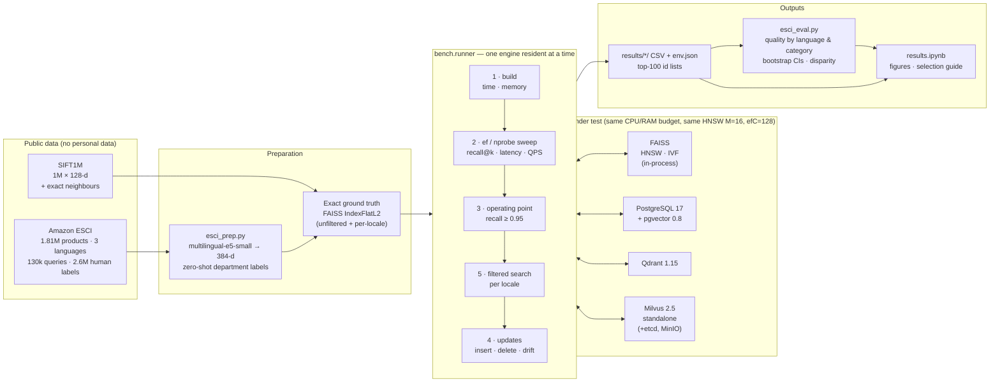

# Vector DB benchmark
### choosing a vector database for semantic product search

## Project details

**Case study.** An e-commerce site wants semantic product search over millions of items.
This project benchmarks **FAISS, pgvector and Qdrant** (Milvus was attempted but dropped —
see [Notes and limitations](#notes-and-limitations)) on recall@k, latency, memory and
index-update cost at **≥1M embeddings**, and checks whether retrieval quality differs
across **product categories and languages** — the Big Data Systems and Responsible AI
halves of the brief respectively.

| # | Name | SRN | Section |
|---|---|---|---|
| 1 | Akshata Amara | PES1UG24AM025 | A |
| 2 | Ankitha Revadala | PES1UG24AM044 | A |

| Component | What we measure | Where |
|---|---|---|
| Big data systems | Recall/latency trade-off, p50/p95/p99, QPS under concurrency, build time, memory, insert/delete throughput, time-to-searchable, recall drift after churn | `bench/runner.py` |
| Responsible AI | nDCG@10 and Exact-match recall per language and category with 95% CIs; how much of each gap comes from the model vs the index/filter; cross-store leakage; deleted items never resurfacing | `bench/esci_eval.py` |

Datasets: **SIFT1M** (1M × 128, shipped exact neighbours) for the systems comparison, and
**Amazon ESCI Shopping Queries** (1,814,924 products in English, Spanish and Japanese, with
human relevance labels, Apache-2.0) for realistic product search and the fairness analysis.
No personal data is used.

---

## Installation

**Requirements:** Docker Desktop (with Compose v2) running, Python 3.11+, ~10 GB free disk.
No `make` or WSL needed — every `make` target below has a plain-command equivalent, and the
two dataset download scripts come in both bash and plain-Python versions, so this runs
natively on Windows, macOS, or Linux.

```bash
git clone <your-repo-url> vdb-bench && cd vdb-bench
python -m venv .venv
source .venv/bin/activate         # Windows (PowerShell): .venv\Scripts\Activate.ps1
pip install -r requirements.txt
cp .env.example .env              # Windows: copy .env.example .env
```

Start the two always-on services (Postgres+pgvector and Qdrant run as Docker containers,
completely separate from any Postgres already installed on your machine):

```bash
docker compose up -d postgres qdrant
docker compose ps                 # both should show "running" / "healthy"
```

If port 5432 is already taken by another Postgres install on your machine (common on
Windows, e.g. via Anaconda), this project's container uses **5433** by default
(`PG_HOST_PORT` in `.env`) specifically to avoid that collision — no change needed unless
5433 is also taken.

## How to run

Three tiers, smallest to largest:

| Run | Data | Purpose | Typical time |
|---|---|---|---|
| `make smoke` | 100,000 synthetic vectors, generated on the spot | Prove the whole pipeline works end-to-end before committing to a long run. **Not for reporting** — the data is artificially easy. | ~3 min |
| `make sift1m` | 1,000,000 real benchmark vectors, downloaded (~500 MB) | The real systems benchmark: speed, accuracy, memory, insert/delete cost | ~50 min for FAISS + pgvector + Qdrant, 2 repeats |
| `make esci` | 1,814,924 real Amazon products, downloaded (~1.1 GB) + embedded via AI model | The real fairness benchmark: quality by language and category | ~70 min on GPU for embedding (~8h on CPU — use Colab/Kaggle), then ~20–80 min per engine for the benchmark itself |

```bash
make smoke                                          # sanity check, ~3 min
make sift1m                                         # full systems benchmark
make esci                                           # full fairness benchmark (needs data/esci_emb/ first)
make notebook                                        # renders results/results.pdf
```

Run a subset of engines with `--engines`, e.g.
`python -m bench.runner --config configs/sift1m.yaml --engines faiss_hnsw,qdrant_hnsw`.
Add `--repeat 2` to run each engine twice and check that numbers are stable, not a fluke of
one run (see [Results](#results) — this is how the pgvector insert-speed finding below was
confirmed real).

**Embedding ESCI needs a GPU to be fast.** This project's embeddings were produced on a
free Google Colab GPU in ~70 minutes (1.8M products at ~438/sec); the same step measured
~63 products/sec on this project's own 32-core CPU, i.e. ~8 hours. See
`docs/demo_script.md` for the exact Colab cell sequence used.

```bash
pip install -r requirements-embed.txt
python -m bench.esci_prep --src data/esci --out data/esci_emb \
       --embedder st:intfloat/multilingual-e5-small --device cuda
# copy data/esci_emb/ back here, then: make esci
```

## Results

### Systems benchmark (SIFT1M, 1M × 128-d vectors, 2 repeats)

Each engine compared at the fastest search setting that still clears 95% recall@10 — not
at default settings, since defaults differ in how conservative they are out of the box.

| Engine | Setting | Recall@10 | p50 latency | p99 latency | Build time | Insert speed | Native delete |
|---|---|---|---|---|---|---|---|
| FAISS HNSW | ef=80 | 0.968 | 0.41 ms | 0.63 ms | 31 s | 4,930 vec/s | No (tombstone + rebuild) |
| FAISS IVF | nprobe=64 | 0.970 | 0.68 ms | 1.35 ms | 37 s | 56,006 vec/s | Yes |
| pgvector (HNSW) | ef=80 | 0.981 | 4.47 ms | 6.18 ms | 403 s | **133 vec/s** | Yes |
| Qdrant (HNSW) | ef=80 | 0.972 | 2.71 ms | 3.89 ms | 271 s | 17,725 vec/s | Yes |

**Headline finding:** pgvector's insert throughput (133–193 vec/s across two repeat runs)
is 100–400x slower than FAISS/Qdrant at this scale — a real, reproducible bottleneck, not
noise. FAISS is fastest and cheapest to query but is an in-process library, not a server:
its latency has no network hop, and it can't delete from an HNSW index without a full
rebuild.

### Fairness benchmark (ESCI, 1.8M real products, FAISS + Qdrant)

Quality measured against real human relevance judgments (nDCG@10), broken down by language
and by category, and compared against an exact (brute-force) search baseline to separate
"the AI embedding model's limitation" from "the database made it worse."

| Breakdown | Best | Worst | Gap (exact search) | Gap added by FAISS | Gap added by Qdrant |
|---|---|---|---|---|---|
| By language | Japanese (0.365) | US/English (0.299) | 0.066 | −0.027 (narrowed it) | −0.015 (narrowed it) |
| By category | Grocery (0.432) | Clothing/jewelry (0.231) | 0.201 | −0.035 (narrowed it) | −0.016 (narrowed it) |

**Headline finding:** the category gap is ~3x bigger than the language gap, and it exists
even under exact search — so it's a limitation of the embedding model, not something either
database adds. Neither FAISS nor Qdrant widened the gap; both tracked (or slightly narrowed)
the exact-search numbers. A secondary finding: at identical HNSW search settings, Qdrant
reached 95–97% recall on these real embeddings, FAISS only 88–90% — same settings did not
mean same accuracy once we moved off synthetic benchmark data.

### Notes and limitations

- **Milvus was excluded.** Its required storage dependency, MinIO, had its public Docker
  Hub images removed in 2025; no substitute image was found without pulling from an
  untrusted third-party mirror. The brief requires "at least three" engines, so this does
  not block the comparison.
- **pgvector was not re-run on ESCI** (only on SIFT1M) due to time constraints before
  submission — its two ESCI config variants (default vs. the 0.8 iterative-scan filtering
  fix) remain queued in `configs/esci.yaml` for a future run.
- All numbers above are from one real run each; `--repeat` was used on SIFT1M (2 repeats,
  consistent results) but not yet on ESCI.

---

## Architecture



## Repository layout

```
bench/
  engines/          one adapter per engine behind a common interface (base.py)
  datasets.py       SIFT1M/GIST/GloVe (ANN-Benchmarks HDF5), ESCI, synthetic
  runner.py         build → sweep → operating point → filtered → updates
  esci_prep.py      ESCI → embeddings, department labels, qrels
  esci_eval.py      quality by language/category, CIs, disparity
  metrics.py        recall@k, latency stats, nDCG, bootstrap
  taxonomy.py       16 departments, described in en/es/ja
configs/            sift1m, esci, smoke, esci_smoke, synthetic1m
notebooks/          results.ipynb (generated by build_notebook.py)
docs/               data card, selection guide, report draft, demo script
docker-compose.yml  Postgres+pgvector, Qdrant, Milvus (profile), bench runner
```

## Make shortcuts reference

`make` is only a shortcut; every target is one or two plain commands, so `make`/WSL are
never required (see [Installation](#installation) / [How to run](#how-to-run) above).

| Make shortcut | Same thing without make |
|---|---|
| `make up` | `docker compose up -d postgres qdrant` |
| `make up-milvus` | `docker compose --profile milvus up -d` (currently broken — see [Notes and limitations](#notes-and-limitations)) |
| `make smoke` | `python -m bench.runner --config configs/smoke.yaml` |
| `make sift1m` | `python scripts/download_ann.py sift-128-euclidean` then `python -m bench.runner --config configs/sift1m.yaml` |
| `make esci` | `python scripts/download_esci.py`, then embed (needs a GPU — see above), then `python -m bench.runner --config configs/esci.yaml` and `python -m bench.esci_eval --run results/esci --emb data/esci_emb` |
| `make notebook` | `python -m jupyter nbconvert --to notebook --execute --inplace notebooks/results.ipynb` then `python -m jupyter nbconvert --to pdf notebooks/results.ipynb --output-dir results` |

Run a subset of engines with `ENGINES=faiss_hnsw,qdrant_hnsw` (make) or `--engines
faiss_hnsw,qdrant_hnsw` (plain Python) — each engine's rows merge into the same CSVs, so
engines can be run separately and incrementally.

**Everything inside Docker** (no local Python needed):

```bash
docker compose --profile bench build
docker compose --profile bench run --rm bench make sift1m
```

## Method notes (read before quoting numbers)

* **Equal footing.** Same HNSW graph parameters (M=16, efConstruction=128), same L2 metric
  (ESCI vectors are unit-normalised, so L2 ranking equals cosine), same CPU/RAM limits per
  container, one engine resident at a time, 50 warm-up queries before timing.
* **Operating point.** Engines are compared at the fastest setting that reaches
  recall@10 ≥ 0.95, not at default settings.
* **FAISS is a library.** Its latencies have no network hop; the databases' do. Both are
  reported, and the gap is part of the decision (a library needs you to build the service).
* **Memory.** `index_mb` is engine-reported; `rss_delta_mb` is measured process/container
  growth. Qdrant and Milvus only expose the latter.
* **Ground truth** is always recomputed with exact search over the vectors actually indexed,
  and checked against SIFT1M's shipped neighbours.
* **Categories** in ESCI are derived (zero-shot) because the dataset has none. See the data card.

## Deliverables

| Brief item | File |
|---|---|
| README, architecture, setup | this file |
| Reproducible pipeline | `Makefile`, `docker-compose.yml`, `configs/` |
| Benchmark harness | `bench/` |
| Results notebook | `results/results.ipynb` → `results/results.pdf` |
| Technical report (3–5 pages) | `docs/report.md` |
| Data card | `docs/data_card.md` |
| Demo video script (3 min) | `docs/demo_script.md` |

## Licences

Code: MIT. SIFT1M: INRIA TEXMEX corpus, research use. Amazon ESCI: Apache-2.0.
multilingual-e5-small: MIT.
